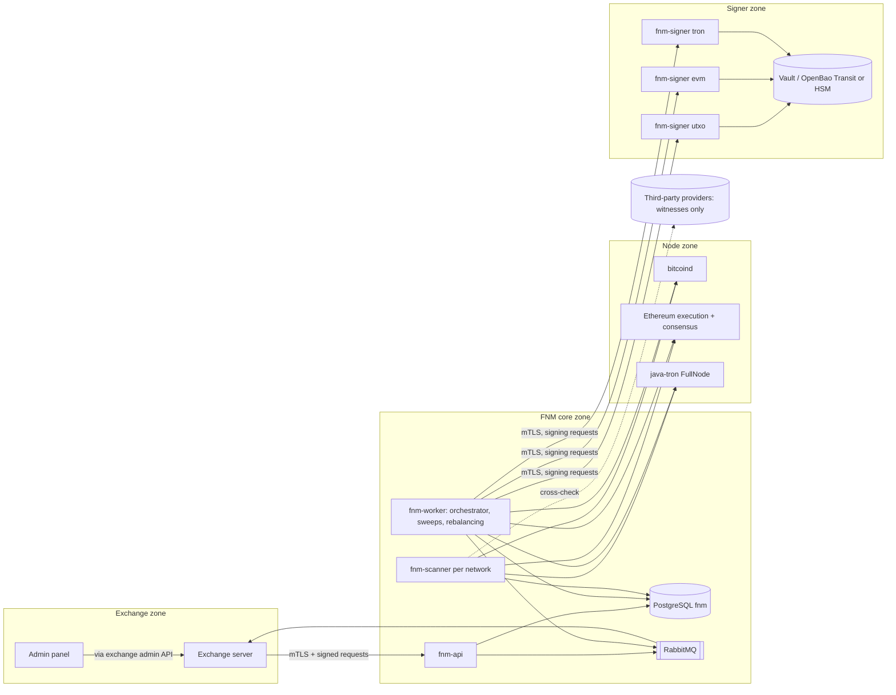

# 02. Architecture

## Components



| Component | Binary | Holds keys | Talks to |
| --- | --- | --- | --- |
| API | `cmd/fnm-api` | No | PostgreSQL, RabbitMQ; called by the exchange |
| Worker | `cmd/fnm-worker` | No | PostgreSQL, nodes, signers, RabbitMQ |
| Scanner | `cmd/fnm-scanner` (one process per network) | No | Its network's nodes, witnesses, PostgreSQL |
| Signer | `cmd/fnm-signer` (one deployment per family, each on its own host) | Yes | Vault/HSM; called only by the worker |
| Node monitor | part of `cmd/fnm-worker` | No | Nodes, reference providers |
| Operator CLI | `cmd/fnmctl` | No (except offline ceremony commands) | PostgreSQL, API |
| Nodes | Bitcoin Core, Geth + Lighthouse, java-tron; later rippled, stellar-core, TON | No | Peer-to-peer network |

Why separate processes: the scanner of one network must not slow another; the API must keep answering while a long sweep runs; and the signer must be small enough to audit and must run where nothing else runs.

## Trust zones

| Zone | Contents | Inbound allowed from | Outbound allowed to |
| --- | --- | --- | --- |
| Exchange | Exchange server | Internet (users) | FNM API only (for chain work) |
| FNM core | API, worker, scanners, PostgreSQL, RabbitMQ | Exchange (API port, mTLS) | Node zone RPC, signer zone, witness providers |
| Node | Full nodes | FNM core (RPC), P2P from internet | P2P to internet |
| Signer | Signers, Vault/HSM | Worker only (mTLS) | Node zone (broadcast fallback only), Vault |
| Offline | Cold keys, seed backups | Nobody | Nobody (QR or removable media) |

Node RPC ports are never exposed outside the node zone. P2P ports are the only internet-facing ports of FNM.

## Data flow examples

**Deposit:** scanner reads a block from our node, matches outputs or logs against the allocated addresses, records a `pending` deposit, raises its confirmations each block, cross-checks it against a witness above a threshold, marks it `final`, and writes `DepositFinalized` to the outbox; the relay publishes it; the exchange credits the ledger and acknowledges.

**Withdrawal:** the exchange, after its own checks and locking the funds, calls `POST /v1/withdrawals` with an idempotency key; FNM validates the address and its own policy, plans the transaction (fee, nonce or UTXOs, batch), asks the signer, broadcasts through two nodes, tracks confirmations, and emits `WithdrawalBroadcast`, `WithdrawalConfirmed` or `WithdrawalFailed`.

## Data stores

PostgreSQL holds networks, nodes and their health, xpubs and derivation state, the address pool and allocations, blocks seen (hash, height, parent) per network, deposits, outgoing transactions and their attempts, UTXOs, nonces, sweeps, wallets and balances, policies and their versions, approvals, the outbox, and the audit log. It is a database of its own, never shared with the exchange. Rows that decide where money goes (addresses, allocations, policies, destinations of transactions) carry a row seal, as in the exchange (`docs/data-protection.md` there).

Redis is optional: locks and leases use PostgreSQL advisory locks, so FNM can start without Redis.

## Repository layout (planned)

```text
cmd/
  fnm-api/         HTTP API for the exchange (mTLS)
  fnm-worker/      orchestrator: withdrawals, sweeps, rebalancing, node monitor, outbox relay
  fnm-scanner/     block scanner, one process per network
  fnm-signer/      signer, built per family (utxo, evm, tron)
  fnmctl/          operator CLI, migrations, ceremonies
internal/
  chain/           the adapter interface and its families: utxo/, evm/, tron/, and the memo family: ton/, xrp/, stellar/
  nodes/           node registry, health, selection, failover
  addresses/       derivation, pool, allocation
  deposits/        scanning, confirmations, reorgs
  withdrawals/     planning, fees, nonces, UTXO selection, tracking
  sweeps/          sweeps, top-ups, consolidation, rebalancing
  wallets/         wallet tiers, balances
  policy/          signing policies, caps, allowlists, approvals
  signer/          signer server and client, key derivation, Vault/HSM
  reconcile/       on-chain against expected balances
  outbox/ audit/ rowseal/ keys/ config/ db/ metrics/ tracing/
deploy/
  nodes/<network>/ compose file, node configuration, .env.example
  fnm/             compose and examples for FNM itself
docs/
```

Code shared with the exchange (row seals, outbox, data-key handling, audit) is copied and adapted, not imported: FNM has no build-time dependency on the exchange, so a change or a compromised dependency there cannot reach the custody ([#70](https://github.com/mdastpak/Crypto-Exchange-Full-Node-Manager/issues/70)).

## Technology

| Area | Choice | Reason |
| --- | --- | --- |
| Language | Go 1.26 | Same as the exchange; strong libraries for Bitcoin (btcsuite), Ethereum (go-ethereum), and the TRON code already in the exchange |
| Database | PostgreSQL 16, pgx, golang-migrate | Same as the exchange; transactions for idempotency and the outbox |
| Messaging | RabbitMQ with a transactional outbox | Same as the exchange; events survive restarts |
| Service API | REST + JSON over mTLS, requests signed with Ed25519, idempotency keys | Consistent with `cmd/tron-signer`; easy to audit |
| Keys | Vault or OpenBao Transit to unwrap seeds; HSM later | Same as the exchange's data-protection keys |
| Nodes | Docker Compose per dedicated host | Fewest moving parts and the smallest attack surface; one node per host already gives the isolation an orchestrator would add ([#70](https://github.com/mdastpak/Crypto-Exchange-Full-Node-Manager/issues/70)) |
| Observability | slog, Prometheus, OpenTelemetry | Same as the exchange |
